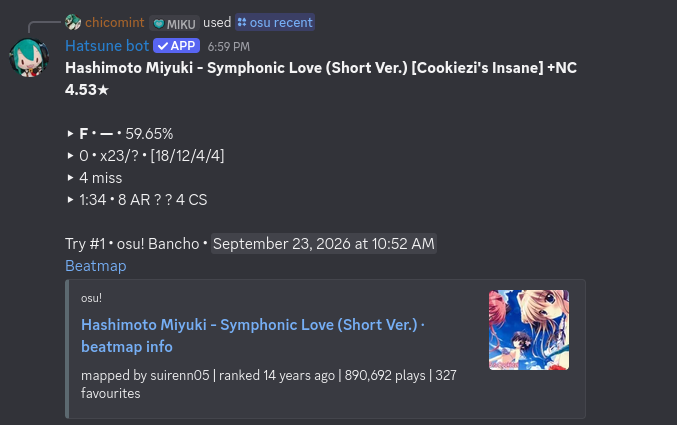
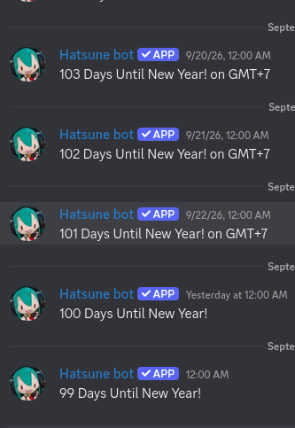

<h1>Hatsune bot!</h1>


<p>
A small Discord bot I originally made for my own server and my friends.
Now anyone can use it too.
</p>

<a href="https://discord.com/discovery/applications/1098589465053765632">
Discord discovery more....
</a>

## Running the existing bot

Use Node.js 22.12 or newer. Install the existing locked dependencies with `npm ci`.
Copy `.env.example` to `.env` if you have not configured the bot yet; keep your
existing configuration when upgrading. Set `DISCORD_TOKEN`, `DISCORD_CLIENT_ID`,
and `MONGODB_URI` as before. No migration of existing data is required. Last
Letter adds one local dictionary dependency and two new MongoDB collections.

The beatmap finder reuses `OSU_CLIENT_ID` and `OSU_CLIENT_SECRET` from the existing
osu! client. Create an OAuth application in your
[osu! account settings](https://osu.ppy.sh/home/account/edit#oauth) if needed.
The bot requests the API v2 `public` scope using client credentials; individual
users do not need to authorize osu! accounts to search maps. Never commit `.env`.

In the Discord Developer Portal, keep **Message Content Intent** enabled for
all `.` commands, and **Server Members Intent** enabled for the existing automatic role
feature. Invite the bot with the `bot` and `applications.commands` scopes.
Give it View Channel, Send Messages, and Embed Links permissions where maps will
be displayed, plus the permissions needed by your existing enabled features.

```sh
npm ci
npm run check
npm test
npm run register
npm start
```

`npm run register` synchronizes the complete command list, including the new
`/osum` and `/lastletter`, using the existing global registration route. Run it after pulling these
changes and whenever slash options change, with `DISCORD_CLIENT_ID` set to the
application belonging to `DISCORD_TOKEN`. It updates commands by name without
adding a second `/osu` or `/osum`. Existing `/help`, `/osu`, `/set`, `/rule`,
`/number`, `/delink`, `/status`, and `/fortune` definitions remain registered.
Registration is explicit; restarting the bot alone does not synchronize commands.
Allow time for Discord clients to refresh global commands. If this application
has an old guild-scoped `/osum` registered separately, remove that obsolete
guild command through its original deployment process so it does not shadow the
global command. This script manages global commands only.

On Railway, keep the existing bot service and MongoDB connection. Configure
`npm run register` as the service's pre-deploy command and `npm start` as its
start command. The existing Railway Variables provide the Discord and MongoDB
credentials; no additional database is needed. A CLI upload deploys local files
without updating GitHub, so commit and push the changed/new source files before
relying on a later GitHub-triggered deployment to retain this version.

## Slash and prefix commands

The osu!, utility, and configuration commands support both `/` and `.`.
Last Letter uses only its two slash commands. **`.r` is an alias for
`/osu recent`**: use `.r` for your linked account, or `.r peppy` for another
player. Usernames with spaces work with or without surrounding quotes.

| Slash command | Prefix equivalent |
| --- | --- |
| `/help` | `.help` |
| `/osu recent` | `.r`, `.osu`, or `.osu recent` |
| `/osu recent username:peppy` | `.r peppy`, `.osu peppy`, or `.osu recent peppy` |
| `/osu add username:peppy` | `.osu add peppy` |
| `/osum name:freedom dive` | `.osum freedom dive` |
| `/osum random:true` | `.osum -r` |
| `/set countdown timezone:GMT+7` | `.set countdown GMT+7` |
| `/set countdown cancel:true` | `.set countdown cancel` |
| `/rule set role:@role` | `.rule set @role` |
| `/rule cancel` | `.rule cancel` |
| `/number enable` | `.number enable` |
| `/number cancel` | `.number cancel` |
| `/delink set channel:#channel` | `.delink set #channel` |
| `/delink cancel` | `.delink cancel` |
| `/status` | `.status` |
| `/fortune` | `.fortune` |
| `/lastletter start` | Slash only; start a game in this channel |
| `/lastletter stop` | Slash only; stop the game and show its results |

Use an actual Discord role/channel mention or its numeric ID for `.rule set`
and `.delink set`. Configuration commands require the server owner,
Administrator permission, or the configured bot owner in both command styles.
Prefix replies appear in the channel; slash configuration replies remain private.
Moderation still runs before prefix commands, and configuration changes stay in
guild message order with counting. `.r`, `.osu`, and `/osu` share their existing
osu! user cooldown and account linking. The finder has its own user cooldown.

Restart the bot to enable these prefix equivalents. They need no additional
slash registration; use `npm run register` if you have not yet synchronized the
beatmap finder's `/osum` command. No `/r` slash command is added.

## Last Letter word-chain game

Register the updated slash commands with `npm run register`, then restart the
bot. There are exactly two Last Letter actions:

```text
/lastletter start [channel:#word-game]
/lastletter stop [channel:#word-game]
```

`start` opens a game in the selected channel (or the current channel if omitted) and displays a random starting
letter. Players then send ordinary words, without commands. For example, if the
starting letter is A: Alice sends `apple`, Bob sends `elephant`, Alice sends
`tiger`, and Bob sends `rabbit`. Alice and Bob each now have a streak of 2.

The next word must start with the last letter of the previous accepted word.
Words are case-insensitive, and every accepted word can be used only once in
that game. Each player has their own current streak and highest game streak;
other players' successes leave those streaks intact. A nonexistent word,
duplicate, wrong letter, sentence, number, or punctuation resets only its
submitter's current streak, without changing the required letter or turn.

**A player can never submit two accepted words consecutively.** After a success,
that player must wait for a different player to submit a valid word. Invalid,
duplicate, and wrong-letter attempts by anyone else do not unlock the turn.
Blocked submissions do not undergo word validation, count as mistakes, or alter
streaks. This is a turn rule with no timer and no number of seconds to wait.
A solo player needs another participant to continue.

Every non-command message in an active game channel is treated as a submission.
Send one word using letters A–Z; surrounding whitespace and letter case are
normalized, while punctuation, hyphens, and apostrophes are not removed. Bot,
webhook, and command messages beginning with `.` or `/` are ignored. Validation
uses the pinned, offline
[`an-array-of-english-words` dictionary](https://github.com/words/an-array-of-english-words)
(version 2.0.0, 274,937 words, derived from the Letterpress word list). It includes
inflections and uncommon words; membership in this word list determines validity.
There is no dictionary API key, network lookup, or rate-limit dependency.

Only a server Administrator, the server owner, or the configured bot owner can
start a game. Everyone with access to the game channel can play. Use
`/lastletter start channel:#word-game` to select a channel, and
`/lastletter stop channel:#word-game` to end it from another channel.
Duplicate active starts are rejected. Starting and stopping both require a
server Administrator, the server owner, or the configured bot owner. Being the
game starter or having Manage Messages alone does not allow stopping the game.
Stopping clears the active turn and displays the top ten players by accepted
word count and by highest game streak. It preserves lifetime best streaks.
Starting again clears words and game streaks and picks a fresh letter, while
lifetime records remain. No extra game, leaderboard, status, or prefix commands
are added. Gameplay uses reactions on each player's own message without posting
per-word messages or embeds:

- ✅ means accepted; digit reactions show the game's total accepted-word count,
  e.g. ✅ 1️⃣ 2️⃣ 3️⃣ for word 123.
- ❌ means an invalid dictionary word, a duplicate, or the wrong starting letter.
- ⏳ means the player must wait for someone else to submit a valid word; their
  streak is unchanged.

Discord allows each distinct emoji only once per message. Counts with repeated
digits, such as 11 or 101, show just ✅ so they cannot be mistaken for a different
number. The exact count and all streaks remain saved in MongoDB. Start and stop
announcements still use embeds, and stopping shows the final results. Gameplay
does not add bot messages or mention players, and cooldowns remain turn-based.

Keep **Message Content Intent** enabled, and grant View Channel, Send Messages
(or Send Messages in Threads), Embed Links, Add Reactions, and Read Message
History in game channels. The existing
`MONGODB_URI` is reused. Mongoose creates these separate collections/indexes
on startup; existing `User` and `Guild` documents are unchanged:

| Collection | Stored data |
| --- | --- |
| `lastlettergames` | One document per guild/channel: active flag, starter, required letter, last successful player, used words, player streaks/word counts, timestamps, revision, and pending lifetime-record updates |
| `lastletterplayers` | Unique Discord user ID and global lifetime best streak |

Game state is written before acknowledging a word. Per-channel queues and
atomic MongoDB revision checks prevent simultaneous messages or bot instances
from bypassing turns or duplicate checks. Lifetime records use `$max`, so a
smaller streak in another game cannot overwrite a larger best. Pending record
updates are stored atomically with accepted turns and retried on startup or
subsequent accepted/start/stop actions in that channel. This survives a crash
between the game write and the lifetime-record write and works with standalone
MongoDB; a replica set or multi-document transactions are not required.

Active games resume from MongoDB after a restart, including used words,
streaks, and the last successful player. Normal gameplay requires a working
database connection; no words are accepted solely in memory during an outage.
Existing moderation runs first, and all osu!, prefix, counting, countdown,
anti-link, and role features remain available.

`npm test` includes turn, streak, validation-order, duplicate, race, restart,
record-recovery, permission, reply-spam, Discord-error, and command-registration
tests. To additionally run the real MongoDB integration test against a local
test server:

```sh
LASTLETTER_TEST_MONGODB_URI=mongodb://127.0.0.1:27017 npm test
```

The integration test creates and drops only its own randomly named disposable
database. This test variable is optional and is not needed to run the bot.

## Beatmap finder: `/osum` and `.osum`

Both command types use the same validation, API search, final filtering, and
embed builder. Each request returns one difficulty. All filters are optional.

```text
.osum freedom dive
.osum freedom dive ar=9
.osum freedom dive ar=9 hp=6 cs=4 acc=98
.osum freedom dive cs=4 ar=9
.osum "freedom dive" 9 6 4 98
.osum "freedom dive" 9 - 4 -
.osum freedom dive time=120-180 stars=4-6
.osum -r
.osum -r ar=9
.osum -r hp=6 cs=4
.osum -r 9 6 4 98
.osum -r ar=9 time=120-180
.osum -r mode=mania cs=4

/osum name:freedom dive
/osum name:freedom dive ar:9 cs:4
/osum name:freedom dive ar:9 hp:6 cs:4 acc:98
/osum random:true
/osum random:true hp:6 cs:4
/osum random:true ar:9 time_min:120 time_max:180 stars_min:4 stars_max:6
/osum random:true mode:mania cs:4
```

Named prefix filters may appear in any order. Quote the name when supplying
positional values: the order is **AR HP CS ACC**, and `-` skips a slot. Random
mode accepts those positional values directly after `-r`. Unquoted numeric
titles remain search keywords. Duplicate values for the same filter are rejected.
Use `.osum` or `/osum` without a name or random mode for usage help. Supplying a
name together with random mode chooses a random match within that keyword search.

| Filter | Meaning and accepted values |
| --- | --- |
| `ar`, `hp` | Exact no-mod map statistic, 0–10 |
| `cs` | Exact no-mod Circle Size, 0–10; up to 18 keys for mania |
| `acc` | Player's target accuracy percentage, 0–100 |
| `time_min`, `time_max` | Inclusive total duration bounds in whole seconds, 0–86400 |
| `stars_min`, `stars_max` | Inclusive no-mod star rating bounds, 0–100 |
| `mode` | `osu` (default), `taiko`, `fruits` (catch), or `mania` |

Prefix commands also accept `time=min-max` and `stars=min-max`; a single value
sets both bounds, e.g. `time=150`. Either bound may be omitted using its named
form, e.g. `time_min=120 stars_max=6`. Minimums cannot exceed maximums. Every
constraint must match the **same difficulty**; the bot never substitutes a
nearby AR/HP/CS value or relaxes filters. Native maps in the chosen mode are
searched across statuses; converted difficulties are excluded.

The embed includes artist/title, mapper, difficulty, stars, AR/HP/CS/OD, BPM,
total duration, status, mode, available cover art, and a clickable difficulty URL.
`acc` is displayed as **Target accuracy**. It does not filter map statistics.
This project has no performance calculator, so PP estimates are unavailable and
no PP numbers are shown. A valid estimate would additionally need the beatmap
file, a supported calculation engine, and assumptions about mods, combo, and
misses. Existing `/osu recent` continues to show actual PP returned for scores.

Name searches follow osu!'s pagination when needed. Random searches choose
random pages across the matching result window, then random eligible
difficulties. For broad searches reaching the 10,000-result offset window, the
finder chooses a random creation year and subdivides it as needed before choosing
a page, so older maps outside the first global pages can be reached. This is
bounded sampling, not a uniform draw from the entire catalogue. Each request
uses at most ten search/detail calls. Every selected difficulty is fetched again
and revalidated to handle stale search entries and deleted maps. If sampling
finds nothing, the response suggests retrying or adjusting the search without
claiming the entire catalogue was exhausted.

Both finder commands share a per-user cooldown controlled by the existing
`OSU_COMMAND_COOLDOWN_SECONDS`. `/osu` keeps its existing separate user cooldown.
All API GETs share a paced queue (at least 1.1 seconds between starts), existing
OAuth token caching/401 renewal, 15-second HTTP timeouts, and a shared cooldown
when osu! responds with HTTP 429 and `Retry-After`. Slash requests defer before
network work and edit that original response when finished. The finder needs no
database reads or writes; existing guild moderation still runs before `.osum`.
Existing `/osu` requests also defer before network work so the shared API queue
does not cause the initial interaction to expire. Linked account lookup uses the
Discord interaction user as well as the existing message author adapter.

Implementation references: [osu! API v2](https://osu.ppy.sh/docs/index.html),
[official search request parameters](https://github.com/ppy/osu-web/blob/master/app/Libraries/Search/BeatmapsetSearchRequestParams.php),
[beatmap search syntax](https://osu.ppy.sh/wiki/en/Beatmap_search), and
[API difficulty fields](https://github.com/ppy/osu-web/blob/master/app/Transformers/BeatmapTransformer.php).

`npm test` runs the original bot regression tests plus finder tests using mocked
osu!/Discord calls. Coverage includes partial and positional filters, numerical
validation, mode handling, cursor pagination, random pages/date partitions,
stale/deleted maps, consistent prefix/slash dispatch, deferred responses,
all prefix equivalents, the `.r` alias, configuration permissions and arrival
order, moderation, cooldowns, rate limiting, and preservation of slash registrations.

